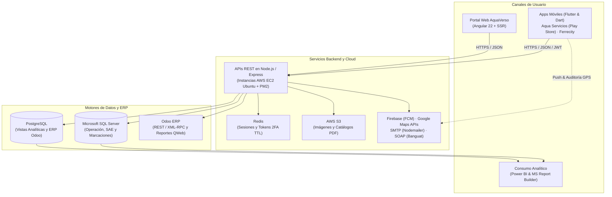

<div align="center">
  
</div>

# Portafolio de Ingeniería y Sistemas en Producción

Documentación de arquitectura, flujos operativos y decisiones técnicas de los sistemas desarrollados, migrados y mantenidos en **Aquasistemas** como **Junior Programmer & Systems Developer**.

> **Nota sobre confidencialidad:** Para resguardar la seguridad y propiedad intelectual de la organización, este repositorio documenta arquitecturas, flujos de datos, patrones de diseño y soluciones técnicas sin exponer código fuente propietario, credenciales, direcciones de red internas ni datos sensibles.

---

## 🗺️ Mapa de Arquitectura General



---

## 📚 Índice de Casos de Estudio

| # | Documento | Sistema / Dominio | Stack Clave | Enfoque Técnico |
| --- | --- | --- | --- | --- |
| 01 | [`docs/01-aquaverso-platform.md`](https://www.google.com/search?q=docs/01-aquaverso-platform.md) | **Plataforma Web AquaVerso** | `Angular 22 (SSR)` `Node.js` `Express` `SQL Server` `PostgreSQL` `Redis` `AWS S3` | Migración web, autenticación 2FA con Redis, inventarios multi-almacén, Fundeleasing, cheques, RRHH y backend multi-BD. |
| 02 | [`docs/02-mobile-aws-ecosystem.md`](https://www.google.com/search?q=docs/02-mobile-aws-ecosystem.md) | **Ecosistema Móvil & AWS** | `Flutter` `Dart` `Google Play` `Google Maps APIs` `FCM` `AWS EC2` `PM2` `Odoo` | App `Aqua Servicios` en Play Store (escudo anti-Fake GPS, 9 formularios, firmas), app B2B `Ferrecity` y servidores AWS. |
| 03 | [`docs/03-powerbi-telemetry-bi.md`](https://www.google.com/search?q=docs/03-powerbi-telemetry-bi.md) | **Business Intelligence (Power BI)** | `Power BI` `DAX` `PostgreSQL` `SQL Server` | Vistas de telemetría GPS (`America/Guatemala`), holgura de agenda, control de manufactura y cortes temporales DAX. |
| 04 | [`docs/04-ssrs-report-builder.md`](https://www.google.com/search?q=docs/04-ssrs-report-builder.md) | **Reportería Paginada (Report Builder)** | `MS Report Builder` `T-SQL` `SQL Server` `Window Functions` `Odoo XML` | Auditoría biométrica de asistencia/retardos, optimización de datasets de crédito/facturación y reportes ERP. |

---

## 🛠️ Stack Consolidado del Entorno Productivo

* **Frontend & Móvil:** Angular 22 (SSR), TypeScript, Flutter, Dart, Provider, HTML5, SCSS/CSS3, JavaScript.
* **Backend & Integraciones:** Node.js, Express, Odoo ERP (REST / XML-RPC), Redis, AWS S3, Firebase Cloud Messaging (FCM), Google Maps APIs, Nodemailer, SOAP.
* **Bases de Datos & BI:** PostgreSQL, Microsoft SQL Server, Power BI Desktop / Report Server, DAX, Microsoft Report Builder (SSRS).
* **Infraestructura & Herramientas:** AWS EC2 (Ubuntu Linux), administración remota SSH / PuTTY, PM2, Google Play Console, Git.

```
