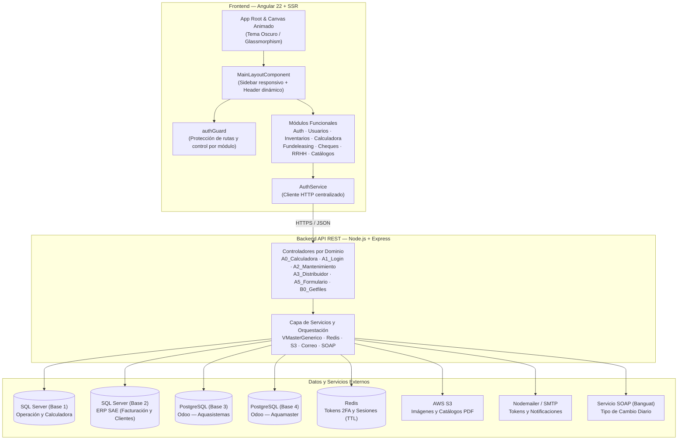
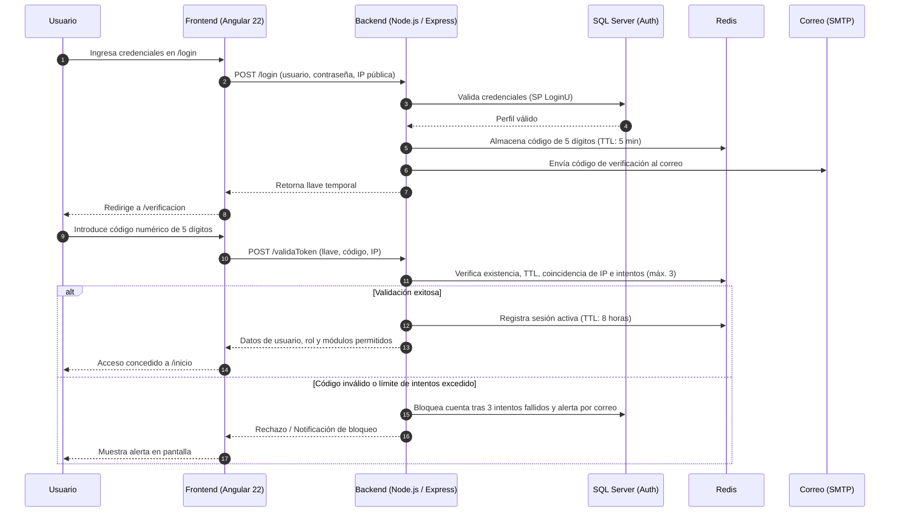
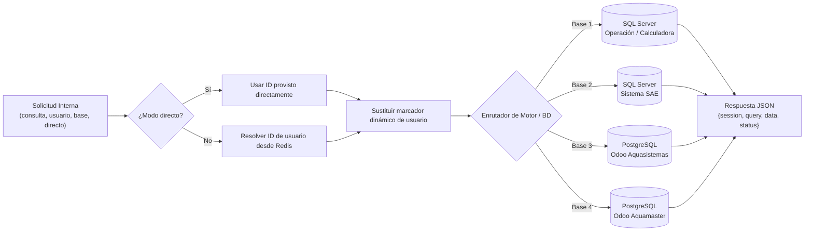

# Caso de Estudio 01: Plataforma Empresarial AquaVerso (`apps.aquaverso.com.gt`)

> **Rol:** Junior Programmer & Systems Developer — Aquasistemas  
> **Stack Frontend:** Angular 22 (SSR), TypeScript, SCSS, RxJS, `pdfmake`, `SweetAlert2`  
> **Stack Backend:** Node.js, Express, SQL Server (`mssql`), PostgreSQL (`pg`), Redis, AWS S3, Nodemailer, SOAP  
> **Tipo de Proyecto:** Sistema Web Empresarial en Producción (Migración, Mantenimiento e Integración Multi-Sistema)

---

## 1. Resumen Ejecutivo y Contexto

**AquaVerso** (`apps.aquaverso.com.gt`) es la plataforma web corporativa que unifica las operaciones comerciales, técnicas, financieras y administrativas de **Aquasistemas** (mantenimiento de piscinas, venta de equipos y químicos, gestión de distribuidores, control financiero y procesos internos).

El ecosistema se compone de dos capas principales:
1. **Frontend (`AquaVerso-v2`):** Aplicación web modernizada mediante migración desde **Angular 17 hacia Angular 22**, configurada con **Server-Side Rendering (SSR)** sobre Express para optimizar tiempos de carga inicial y estructurada bajo una arquitectura modular orientada a dominios funcionales.

2. **Backend:** API RESTful desarrollada en **Node.js** y **Express** que actúa como orquestador central entre múltiples motores de bases de datos (**SQL Server** y **PostgreSQL**), caché en memoria (**Redis**), almacenamiento en la nube (**AWS S3**), notificaciones transaccionales (**SMTP / Nodemailer**) y servicios web externos (**SOAP**).

---

## 2. Arquitectura General del Sistema



---

## 3. Ingeniería del Frontend (`Angular 22 + SSR`)

### 3.1. Estructura Modular (`core` / `features`)

El proyecto separa la infraestructura transversal (`core`: guardias de navegación, layout principal y servicios HTTP) de los módulos de negocio (`features`), facilitando la escalabilidad y el mantenimiento del código tras la migración de versión:

```text
src/app/
├── core/
│   ├── guards/          # authGuard (validación de sesión y permisos por módulo)
│   ├── layout/          # MainLayoutComponent (menú lateral dinámico y cabecera)
│   └── services/        # AuthService (comunicación REST y activos para PDF)
└── features/
    ├── auth/            # Login y verificación en dos pasos (2FA)
    ├── calculadoras/    # Dosificación química para piscinas
    ├── cheques/         # Emisión y autorización de cheques de gerencia
    ├── formularios/     # Solicitud de empleo multipaso (RRHH) y garantías
    ├── fundeleasing/    # Fundea Maestra, Historial de Pagos y Vista de Bolsones
    ├── inventarios/     # Catálogos Interno, Externo, Hidromaster y El Salvador
    ├── usuarios/        # Administración de cuentas, estados y permisos
    └── catalogos/       # Visualización y descarga de catálogos técnicos

```

### 3.2. Seguridad y Flujo de Autenticación en Dos Pasos (2FA)

El acceso a la plataforma implementa validación de doble factor vinculada a la dirección IP pública del cliente y respaldada por **Redis** en el servidor:



### 3.3. Módulos Funcionales Desarrollados y Mantenidos

* **Control de Usuarios y Permisos:** Creación y actualización de perfiles, activación/suspensión de cuentas y asignación granular de módulos mediante interruptores dinámicos que actualizan la matriz de acceso de cada usuario.
* **Inventarios Multi-Almacén y Multi-Contexto:**
* Búsquedas optimizadas con *debounce* de `500 ms` para evitar saturación de peticiones.
* **Inventario Interno e Hidromaster:** Simulación de descuentos en tiempo real y consulta modal de existencias desglosadas por almacén desde Odoo/SAE.
* **Inventario Externo y Regional (El Salvador):** Consulta de catálogo público y conversión automática a dólares mediante tasa de cambio obtenida dinámicamente.


* **Calculadora Química de Piscinas:** Motor de cálculo en frontend que evalúa volumen (galones), tipo de cloro, cloro libre/total, pH, alcalinidad, dureza, temperatura, turbidez y presencia de algas para determinar dosis exactas, orden de aplicación y almacenamiento histórico.
* **Módulo Fundeleasing (`fundea-maestra`, `historial-fundea`, `vista-bolsones`):**
* Consulta de facturas por cliente y rango de fechas, cálculo de descuentos, intereses diferenciados y adelanto neto.
* Validación de línea de crédito disponible, registro transaccional de cabecera/detalle de bolsones y gestión de abonos/cierres de facturas.
* Generación de documentos PDF directamente en el cliente mediante `pdfmake`.


* **Cheques de Gerencia:** Panel con totales acumulados por moneda (GTQ / USD), filtros por cuenta bancaria y texto, emisión de nuevos cheques y flujo de autorización/anulación según el estado del documento.
* **Formulario Multipaso de RRHH:** Captura estructurada en **6 etapas** (datos personales, núcleo familiar, formación académica, historial laboral, salud/situación socioeconómica y referencias) con carga de hasta 10 documentos adjuntos codificados en Base64 y validación de tamaño/extensión.
* **Experiencia Visual (*Universe & Water*):** Interfaz oscura con paneles *glassmorphism* (`backdrop-filter`), tipografía *Outfit* y fondos interactivos optimizados.

---

## 4. Ingeniería del Backend 

### 4.1. Orquestación Multi-Base de Datos (`VMasterGenerico`)

Uno de los pilares técnicos del backend es su capa de ejecución genérica (`VMasterGenerico`), diseñada para consultar de forma unificada **cuatro bases de datos heterogéneas** según el dominio de negocio:



### 4.2. Servicios Transversales e Integraciones

* **Gestión de Estado en Redis:** Administración centralizada del ciclo de vida de tokens 2FA (5 minutos) y sesiones de usuario (8 horas), controlando intentos fallidos y preservando tiempos de expiración al actualizar registros.
* **Procesamiento de Imágenes y AWS S3:** Recepción de archivos en Base64, conversión automática de formatos especiales (`HEIC`, `HEIF`, `SVG`, `TIFF`) a formatos web estándar mediante `sharp` y `canvas`, y gestión de carga/eliminación en buckets de **AWS S3** (`@aws-sdk/client-s3`).
* **Integración SOAP y Automatización de Correos:**
* Consumo y parseo XML (`jsdom`) del servicio web **SOAP** del Banco de Guatemala para obtener la tasa de cambio oficial del día.
* Envío automatizado de correos HTML mediante **Nodemailer** para códigos 2FA, creación de bolsones Fundea, solicitudes de empleo, garantías, cotizaciones y alertas de seguridad.


* **Gestión de Órdenes de Instalación y Garantías:** Endpoints transaccionales para registro de cabeceras, detalles, vinculación de documentos SAE, adjuntos fotográficos y registros de cableado eléctrico.

---

## 5. Despliegue y Consideraciones Técnicas

* **Ejecución y SSR:** Compilación optimizada con Angular CLI (`npm run build`) y despliegue del servidor Node.js con soporte SSR (`npm run serve:ssr:aquaverso-v2`), gestionado en entornos Linux mediante **PM2** para garantizar continuidad operativa y reinicio automático ante fallos.
* **Criterio de Seguridad y Evolución:** Durante la documentación y auditoría técnica del sistema se establecieron como líneas de mejora continua la externalización completa de credenciales hacia variables de entorno (`.env`), el endurecimiento de cabeceras HTTP mediante `helmet`, políticas CORS estrictas por dominio y la transición de cookies accesibles en cliente hacia mecanismos `HttpOnly` / tokens renovables.
