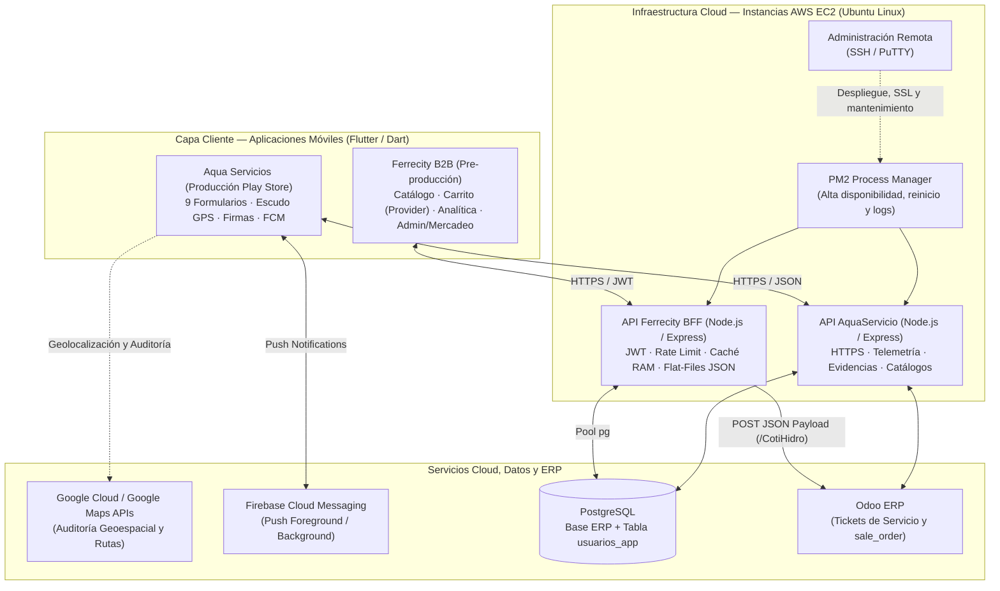
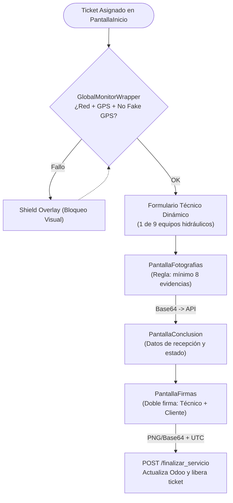
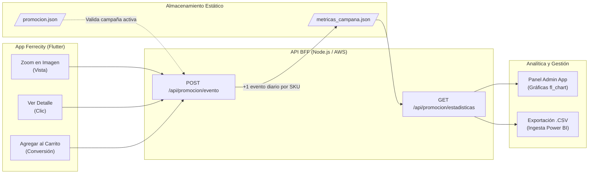
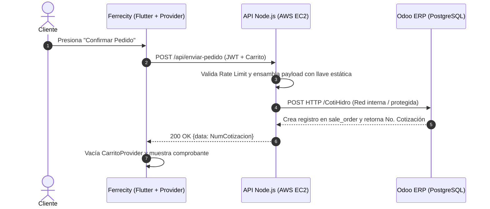

# Caso de Estudio 02: Ecosistema Móvil (`Aqua Servicios` y `Ferrecity`) e Infraestructura AWS

> **Rol:** Junior Programmer & Systems Developer — Aquasistemas  
> **Stack Móvil:** Flutter, Dart, Provider, Firebase Cloud Messaging (FCM), Google Maps APIs / Google Cloud, Geolocator, `fl_chart`, `signature`, `image_picker`  
> **Stack Backend & Cloud:** Node.js, Express, AWS EC2 (Ubuntu Linux), SSH / PuTTY, PM2, PostgreSQL (`pg`), Odoo ERP (REST / XML-RPC), JWT, `bcrypt`  
> **Estado de Despliegue:** `Aqua Servicios` publicada en producción en **Google Play Store** (`v1.0.2` / `.aab`) · `Ferrecity` desarrollada e integrada en entorno de pre-producción

---

## 1. Resumen Ejecutivo y Contexto

Para digitalizar las operaciones fuera de oficina —tanto el mantenimiento técnico en sitio como la autogestión de pedidos B2B—, se diseñaron y construyeron **dos aplicaciones móviles multiplataforma en Flutter** respaldadas por **APIs intermediarias en Node.js** alojadas en instancias **EC2 de Amazon Web Services (AWS)**:

1. **`Aqua Servicios` (En Producción — Google Play Store):** Aplicación operativa para técnicos de campo especializados en equipos hidráulicos y tratamiento de agua, publicada en producción para reemplazar un sistema heredado. Incorpora 9 formularios técnicos dinámicos, evidencia fotográfica obligatoria, firmas digitales, notificaciones push (FCM), escudo anti-fraude (*Fake GPS*) y auditoría satelital apoyada en **APIs de Google Maps / Google Cloud**.
2. **`Ferrecity` (Ecosistema B2B — App Móvil + API BFF):** Plataforma de comercio electrónico B2B construida bajo el patrón **BFF (*Backend For Frontend*)** sobre Odoo ERP. Protege la base de datos central mediante persistencia híbrida (PostgreSQL + archivos planos JSON + caché en RAM), control de tráfico (*Rate Limiting*), motor de analítica silenciosa y paneles administrativos con gráficas en tiempo real.

---

## 2. Arquitectura General del Ecosistema Móvil y Cloud

---

## 3. App 1: `Aqua Servicios` (Producción en Google Play Store)

### 3.1. Escudo de Seguridad Global (`GlobalMonitorWrapper`) y Ciclo de Vida

Toda la jerarquía de navegación de la aplicación está envuelta mediante el parámetro `builder` del `MaterialApp` en `GlobalMonitorWrapper` (implementando `WidgetsBindingObserver`), garantizando control operativo continuo:

* **Monitoreo de Conectividad y Sensor GPS:** Escucha en tiempo real cambios de red (`connectivity_plus`) y disponibilidad del servicio de localización (`geolocator`).
* **Protección Anti-Fake GPS:** Evalúa el indicador nativo del sistema operativo (`Position.isMocked`) para detectar aplicaciones de ubicación simulada.
* **Bloqueo Visual Inmediato (*Shield Overlay*):** Si el dispositivo pierde conexión a internet, apaga el GPS o inyecta coordenadas falsas, la app superpone una pantalla de bloqueo difuminada (`BackdropFilter`) que impide cualquier interacción hasta restablecer condiciones válidas.
* **Gestión de Ciclo de Vida:** Detecta transiciones entre primer plano (`resumed`) y segundo plano (`paused`/`hidden`), ajustando el temporizador de telemetría (envío cada 1 minuto en estado `ACTIVA` y ráfaga de cierre `MINIMIZADA` al suspender).

### 3.2. Auditoría Satelital, Telemetría y APIs de Google Maps

Para brindar trazabilidad completa sobre las visitas técnicas en campo, se implementó el servicio `AuditoriaService` integrado con **Google Cloud y APIs de Google Maps**:

* **Captura de Telemetría Operativa:** Recolecta latitud, longitud, altitud, precisión satelital, porcentaje de batería (`battery_plus`), estado de la app y ticket activo (`SharedPreferences`), enviándolos periódicamente al backend (`POST /AquaServicio/telemetria`).
* **Auditoría Geoespacial y Panel Administrativo (`PantallaAdmin`):** Integración con **Google Maps APIs** y configuración de credenciales en **Google Cloud** para el seguimiento y verificación de ubicaciones de las cuadrillas, complementado con un panel administrativo que permite exportar historiales de auditoría en formato `.csv` para visualización de rutas.

### 3.3. Formularios Técnicos Dinámicos, Evidencias y Cierre Legal

La aplicación estandariza el diagnóstico de campo mediante una librería propia de componentes *Glassmorphism* (`widgets_formulario.dart`: `NeonSectionTitle`, `GlassTextInput`, `GlassDropdown`, `GlassCheckbox` y `GlassFormScaffold` con validación de campos obligatorios marcados con `*` y mapeo de relaciones *Many2One* hacia IDs de Odoo).

| Módulo / Pantalla | Responsabilidad Técnica |
| --- | --- |
| **`PantallaInicio` y `PantallaServicio**` | Dashboard de tickets pendientes desde Odoo, historial de cerrados, carrusel de fotografías previas del vendedor y ruteo automático según el `Tipo de Formato`. |
| **9 Formularios Especializados** | Captura de parámetros técnicos para: **Filtración**, **Calentador Eléctrico**, **Calentador de Gas**, **Equipo Sumergible**, **Piscina**, **Hidroneumático**, **Equipo Confort**, **Generador Húmedo/Seco** y **Edificios**, cargando catálogos dinámicos desde PostgreSQL (`/opciones_select`). |
| **`PantallaFotografias`** | Captura mediante cámara nativa o galería (`image_picker`) con regla estricta de **mínimo 8 fotografías**, codificación a Base64 y envío al servidor. |
| **`PantallaConclusion` y `PantallaFirmas**` | Registro de recepción del servicio y captura de **doble firma digital** (técnico y cliente) en lienzos `signature`, exportadas a PNG/Base64 con *timestamp* UTC para el cierre transaccional en Odoo (`POST /finalizar_servicio`). |

### 3.4. Notificaciones Push (FCM) y Publicación en Google Play Console

* **Firebase Cloud Messaging:** Registro de tokens FCM por técnico (`/actualizar_token`), manejo de notificaciones en segundo plano mediante *Isolate* (`@pragma('vm:entry-point')`) y diálogos en primer plano usando `GlobalKey<NavigatorState>`.
* **Cumplimiento y Lanzamiento en Play Store:** Compilación de artefactos firmados (`flutter build appbundle --release`), configuración de declaraciones de seguridad de datos, clasificación de contenido y resolución de auditorías de Google Play para permisos sensibles (`ACCESS_FINE_LOCATION`, `ACCESS_COARSE_LOCATION`, `FOREGROUND_SERVICE_LOCATION` y `BACKGROUND_LOCATION`) implementando flujos de **Divulgación Prominente (*Prominent Disclosure*)**.

---

## 4. App 2: Ecosistema B2B `Ferrecity` (App Móvil + API BFF)

### 4.1. Arquitectura BFF y Persistencia Híbrida de Datos

El backend en Node.js/Express actúa como un **Backend For Frontend (BFF)** diseñado para desacoplar la app móvil de Odoo ERP y evitar cuellos de botella por alta concurrencia mediante un modelo de datos híbrido:

* **PostgreSQL (Pool de conexiones `pg`):** Lectura optimizada del catálogo, existencias e historial de compras (`sale_order` y `res_partner` de Odoo), extendido con la tabla propia `usuarios_app` (enlazada lógicamente a `res_partner.id`) para gestionar credenciales encriptadas (`bcrypt`, *salt* 10) y roles (`usuario`, `mercadeo`, `admin`).
* **Archivos Planos JSON (`fs.promises`) y Caché en RAM:**
* `promocion.json`: Controla el estado activo y el recurso (URL/Base64) de las campañas promocionales sin consultas SQL repetitivas.
* `metricas_campana.json`: Motor de analítica silenciosa que registra eventos diarios por SKU (`vistas`, `clics`, `conversiones`) sin bloquear el hilo principal ni sobrecargar PostgreSQL.

* **Seguridad y Control de Tráfico:** Autenticación *stateless* con **JWT** y doble capa de `express-rate-limit` (300 req/15 min general y 10 req/15 min estricto para login e inyección de pedidos).

### 4.2. Experiencia Móvil por Roles y Flujo Transaccional hacia Odoo

Construida en **Flutter** con gestión de estado global mediante **Provider** (`CarritoProvider`), estética *Glassmorphism* (paleta Azul Naval y Rojo City), paginación infinita (`ScrollController`), búsqueda con *debounce* e inspección de productos con `InteractiveViewer`:

* **Rol Cliente:** Validación de NIT contra `res_partner` en Odoo, creación de contraseña, exploración de catálogo, gestión de carrito reactivo, envío de pedidos y consulta de historial (`sale_order`) con etiquetas de estado.
* **Rol Administrador:** Panel de control con tarjetas KPI, gráficas de tendencias multiplínea (`fl_chart`), exportación de métricas a `.csv` para Power BI y CRUD completo de usuarios (cambio de roles y revocación de acceso).
* **Rol Mercadeo:** Panel simplificado para activar/desactivar campañas y actualizar banners promocionales en tiempo real.

---

## 5. Infraestructura Cloud en AWS y Operación con PM2

Los servicios backend de ambas aplicaciones (`API AquaServicio`, `ferrecity-api` y `backend-insertar-pedidos`) se despliegan y operan sobre **instancias EC2 con Ubuntu Linux en AWS**:

* **Administración Remota (SSH / PuTTY):** Conexión directa a las instancias cloud para aprovisionamiento de Node.js, configuración de certificados SSL/TLS, aislamiento de secretos en `.env` y despliegue de versiones.
* **Orquestación con PM2:** Gestión de procesos en segundo plano (`pm2 start`, `pm2 restart`, `pm2 startup`, `pm2 save`) para garantizar reinicio automático tras fallos o reinicios del servidor, junto con monitoreo continuo de logs de red y transacciones hacia Odoo y PostgreSQL.

