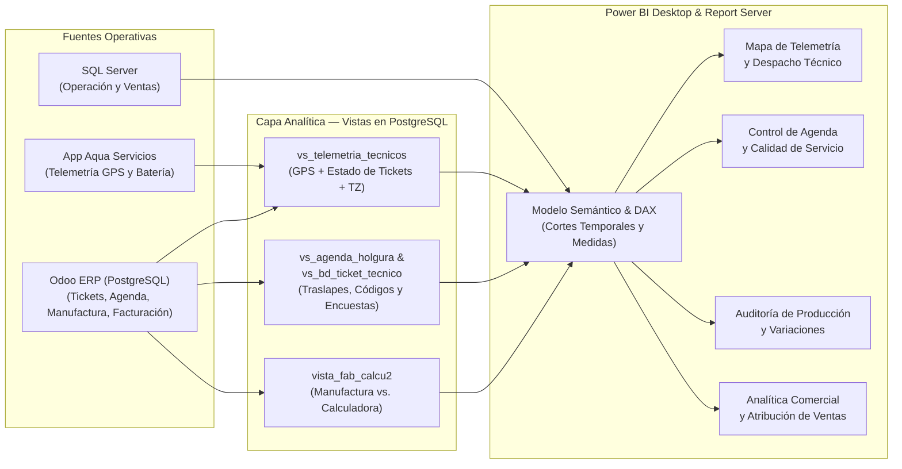

# Caso de Estudio 03: Business Intelligence, Telemetría y Modelado Analítico en Power BI

> **Rol:** Junior Programmer & Systems Developer — Aquasistemas  
> **Stack Principal:** Power BI Desktop, Power BI Report Server, DAX, PostgreSQL (`pgAdmin 4`), SQL Server, Odoo ERP  
> **Enfoque:** Ingeniería de vistas SQL, conversión de zonas horarias (`America/Guatemala`), analítica geoespacial, control de manufactura y modelado temporal en DAX

---

## 1. Resumen Ejecutivo y Contexto

Para transformar los datos operativos dispersos entre el ERP (**Odoo / PostgreSQL**), la telemetría móvil (**Aqua Servicios**) y los sistemas comerciales en decisiones gerenciales accionables, se diseñó una capa analítica basada en **vistas optimizadas en PostgreSQL** y **modelos de datos en Power BI**.

El objetivo técnico fue descargar la lógica pesada de cruces, limpieza y cálculo hacia el motor de base de datos, permitiendo que **Power BI** opere con modelos limpios, filtros dinámicos por fecha y visualizaciones de alto impacto (mapas oscuros, *tooltips* personalizados y formato condicional).

---

## 2. Arquitectura del Pipeline de Datos y BI

---

## 3. Suites Analíticas y Vistas SQL Desarrolladas

### 3.1. Telemetría GPS y Despacho Técnico en Tiempo Real (`vs_telemetria_tecnicos`)

Modelo geoespacial diseñado para monitorear en vivo la ubicación, estado de dispositivos y avance de órdenes de servicio de las cuadrillas técnicas en campo:

* **Ingeniería en PostgreSQL:** Creación de la vista `vs_telemetria_tecnicos` cruzando los registros crudos de telemetría (`tecnico_telemetria`: coordenadas GPS, nivel de batería, estado de la app y *timestamps*) con el maestro de órdenes de servicio (`x_servicios`) y sus estados (`x_estado`).
* **Normalización de Zona Horaria:** Conversión explícita de marcas de tiempo almacenadas en **UTC** hacia la zona horaria local **`America/Guatemala`** directamente en SQL para evitar desfases en reportes diarios.
* **Visualización en Power BI:**
* Mapa interactivo con **tema oscuro corporativo** y categorización espacial de Latitud y Longitud.
* Segmentadores (*slicers*) dinámicos por fecha, técnico y estado del ticket.
* ***Tooltips* personalizados** que muestran al pasar el cursor sobre cada punto: cliente, dirección del servicio, problema reportado, fecha programada, batería del teléfono y estado de la aplicación.

### 3.2. Control de Agenda, Holguras y Calidad de Servicio (`vs_agenda_holgura` y `vs_bd_ticket_tecnico`)

Conjunto de vistas orientadas a optimizar la planificación de rutas y auditar el cumplimiento post-servicio:

* **Detección de traslapes de horario (`vs_agenda_holgura`):** Lógica SQL para calcular la holgura entre visitas consecutivas de un mismo técnico, alertando automáticamente cuando existen traslapes o márgenes menores a 1 hora entre servicios programados.
* **Seguimiento de facturación y encuestas (`vs_bd_ticket_tecnico`):** Consolidación de códigos de facturación de servicios técnicos y monitoreo de tasas de envío/entrega de encuestas de satisfacción al cliente.

### 3.3. Control de Producción y Manufactura (`vista_fab_calcu2`)

Vista analítica creada para auditar la precisión entre las cantidades presupuestadas/calculadas y las unidades realmente fabricadas:

* **Filtrado dinámico por fechas:** Estructuración de `vista_fab_calcu2` en PostgreSQL exponiendo dimensiones temporales limpias para habilitar rangos de fecha flexibles en Power BI.
* **Auditoría visual de variaciones:** Implementación de totales, subtotales y reglas de **formato condicional** sobre la métrica `diferencia_unidades` para resaltar de inmediato excedentes, faltantes o cumplimiento exacto entre calculadora y manufactura.

### 3.4. Analítica Comercial y Atribución Histórica en DAX

Resolución de un reto clásico de calidad de datos en carteras comerciales compartidas:

* **Lógica de corte temporal en DAX:** Diseño de medidas y columnas calculadas con reglas de fecha de corte para separar y atribuir correctamente el historial de ventas de distintas ejecutivas comerciales que operaron secuencialmente bajo una misma cuenta de correo corporativo, preservando intactos los registros originales del ERP.
* **Consultas contables personalizadas:** Filtrado especializado en SQL sobre diarios contables específicos en Odoo para auditar la creación de facturas por equipo administrativo.

---

## 4. Buenas Prácticas Aplicadas

* **Cálculo en origen (*Push-down*):** Las conversiones de zona horaria, cruces de tablas transaccionales y cálculos de holgura se resuelven en vistas de PostgreSQL para mantener los archivos `.pbix` ligeros y rápidos al actualizar en **Power BI Report Server**.
* **Identidad visual consistente:** Aplicación de temas corporativos en modo oscuro con acentos cian/turquesa, jerarquía clara de KPIs y *tooltips* informativos que evitan sobrecargar las tablas principales.

