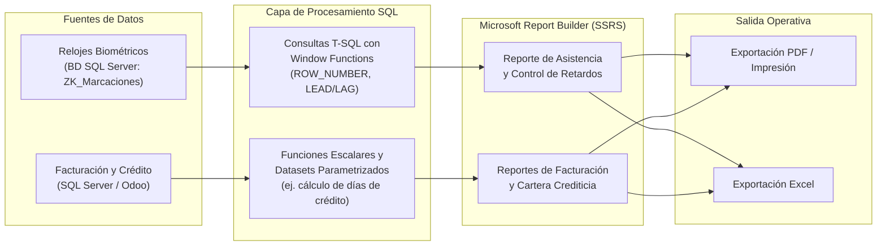

# Caso de Estudio 04: Reportería Operativa y Paginada en Microsoft Report Builder (SSRS)

> **Rol:** Junior Programmer & Systems Developer — Aquasistemas  
> **Stack Principal:** Microsoft Report Builder (`15.1.30001.02`), SQL Server Reporting Services (SSRS), T-SQL, SQL Server (`ZK_Marcaciones`, `SAE`), PostgreSQL (`Odoo`), Window Functions  
> **Enfoque:** Reportes paginados de auditoría biométrica, optimización de datasets financieros/crediticios y personalización de reportes ERP

---

## 1. Resumen Ejecutivo y Contexto

A diferencia de los tableros exploratorios en Power BI, ciertas áreas operativas (Recursos Humanos, Créditos, Facturación y Contabilidad) requieren **reportes paginados con formato estricto** listos para auditoría, impresión y exportación a PDF/Excel.

Para cubrir estas necesidades se diseñaron, optimizaron y mantuvieron reportes en **Microsoft Report Builder (SSRS)** respaldados por consultas avanzadas en **T-SQL** y funciones en base de datos, logrando automatizar controles que antes requerían cruces manuales en hojas de cálculo.

---

## 2. Arquitectura del Flujo de Reportería Paginada

---

## 3. Reportes y Soluciones Desarrolladas

### 3.1. Control de Asistencia y Puntualidad Biométrica (`ZK_Marcaciones`)

Desarrollo de un reporte paginado de auditoría para Recursos Humanos conectado directamente a la base de datos de marcaciones biométricas del personal:

* **Procesamiento de eventos crudos con SQL *Window Functions*:** Los relojes biométricos registran múltiples marcas secuenciales por empleado al día (entradas, salidas a almuerzo, reingresos y salidas finales). Se implementaron consultas en **T-SQL** usando funciones de ventana (`ROW_NUMBER()`, `LAG()`, `LEAD()`, `PARTITION BY`) para agrupar y ordenar las marcaciones por colaborador y fecha sin perder precisión.
* **Detección automática de incidencias:** Cálculo exacto de minutos de retardo, salidas anticipadas, marcaciones incompletas y horas laboradas efectivas, presentados en tablas paginadas con filtros por rango de fechas y departamento.

### 3.2. Reportería Crediticia y Facturación (`FACT_FUNDEA`)

Mantenimiento y evolución de reportes financieros críticos utilizados para el seguimiento de cartera y condiciones de crédito:

* **Lógica de días de crédito:** Actualización y optimización de la función de consulta de días de crédito (`x_dias_credito_fundea`) para garantizar consistencia entre las reglas comerciales vigentes y los documentos emitidos.
* **Optimización de Datasets en Report Builder:** Ajuste y depuración de conjuntos de datos complejos (`DataSet1`, `DataSet5`) para asegurar integridad en totales, saldos pendientes y tiempos de respuesta al renderizar reportes con alto volumen de facturas.

### 3.3. Personalización de Plantillas de Reportes ERP (Odoo XML)

Complementariamente a SSRS, se realizaron ajustes sobre plantillas de reportes **XML/QWeb en Odoo** para adecuar documentos operativos y de impresión a las necesidades del negocio (eliminación de saltos de paginación innecesarios, limpieza de campos específicos del cliente y estandarización del formato de salida).

---

## 4. Impacto Técnico

* **Automatización de auditorías:** Eliminación de manipulación manual de archivos exportados desde relojes biométricos, reduciendo errores humanos en el cálculo de puntualidad.
* **Integridad financiera:** Centralización del cálculo de días de crédito directamente en base de datos, evitando discrepancias entre distintos reportes de cartera.
* **Rendimiento en generación:** Uso de *Window Functions* y filtrado parametrizado en origen para generar documentos PDF/Excel con rapidez y paginación limpia.